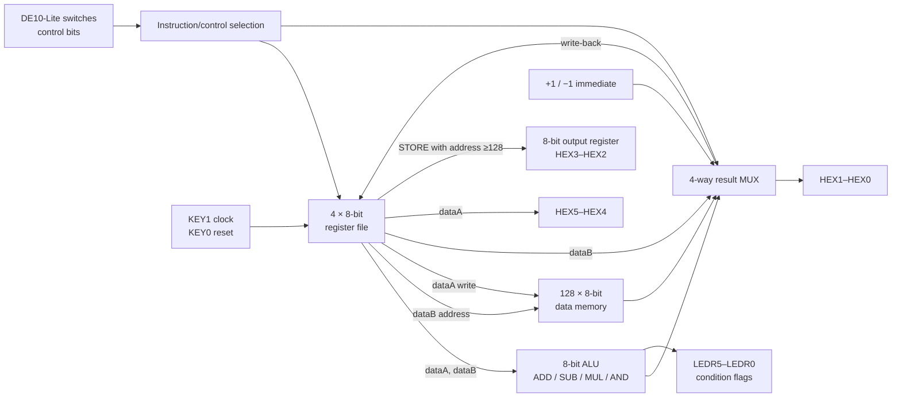

# 8-Bit SimpleCPU on FPGA

**A manually programmed 8-bit CPU datapath built in SystemVerilog and demonstrated on a Terasic DE10-Lite FPGA board.**

`SystemVerilog` · `Quartus Prime Lite` · `DE10-Lite / MAX 10` · `Digital Logic` · `ALU` · `Register File` · `Memory-Mapped I/O`

> **Project status:** I implemented the ALU, register file, CPU datapath, and FPGA board interface and got the lab design working on the DE10-Lite. Source files and a board pin configuration are included. New simulation smoke tests are provided but **have not been run** in this repository environment.

## Project at a glance

| Feature | Implementation |
| --- | --- |
| Datapath width | **8 bits** |
| Arithmetic logic unit | **ADD, SUB, MUL, AND** |
| Condition codes | Six flags: carry, borrow, signed overflow variants, negative, zero |
| Register file | **Four 8-bit registers**, two combinational read ports, one synchronous write port |
| Data memory | **128 × 8-bit locations** (128 bytes) |
| Output peripheral | 8-bit memory-mapped `outReg` displayed on HEX3–HEX2 |
| Instruction input | DE10-Lite switches set control signals manually |
| Clock and reset | KEY1 advances one instruction when released; KEY0 is active-low reset |
| Debug output | Six hexadecimal displays and six condition-code LEDs |

**Scope:** This is an educational **CPU datapath with manually supplied instructions**, not a general-purpose processor with an instruction memory, program counter, automatic instruction fetch, or branch unit. Its arithmetic, register, memory, and output operations run in hardware.

## Architecture



This design combines **combinational logic** (ALU, register reads, result selection) with **sequential state** (register writes, memory writes, and output register updates).

See [architecture notes](docs/architecture.md) for the complete datapath explanation.

## Instruction control

The CPU executes one manually specified operation on each active clock edge. Switch settings encode which registers to read, which operation to perform, and which result to write back.

| Board input | Function |
| --- | --- |
| `SW[9]` | `wrA`: 1 writes a register, 0 selects STORE |
| `SW[8:7]` | `selA`: destination / first source register (R0–R3) |
| `SW[6:5]` | `selB`: second source register / memory address register |
| `SW[4:3]` | `aluOp`: ADD=00, SUB=01, MUL=10, AND=11 |
| `SW[2]` | `imm`: 0 selects +1, 1 selects −1 (as 8-bit `0xFF`) |
| `SW[1:0]` | `selR`: result source: ALU=00, dataB=01, memory=10, immediate=11 |
| `KEY[0]` | Active-low reset for the register file and output register |
| `KEY[1]` | Manually controlled clock; the register update occurs on release |

### Supported instruction behaviours

| Conceptual instruction | Control behaviour |
| --- | --- |
| `ADD rA, rB` | `wrA=1, selR=00, aluOp=00` |
| `SUB rA, rB` | `wrA=1, selR=00, aluOp=01` |
| `MUL rA, rB` | `wrA=1, selR=00, aluOp=10` |
| `AND rA, rB` | `wrA=1, selR=00, aluOp=11` |
| `MOV rA, rB` | `wrA=1, selR=01` |
| `MOV rA, +1/-1` | `wrA=1, selR=11`, use `imm` to select |
| `LOAD rA, [rB]` | `wrA=1, selR=10` reads `mem[dataB[6:0]]` |
| `STORE rA, [rB]` | `wrA=0` writes `dataA` to memory or the output register based on `dataB[7]` |

**Address decoding:** STORE uses the lower seven bits of `rB` to address the 128-byte memory when bit 7 is 0; when bit 7 is 1, the same STORE writes the output register instead.

## FPGA display and debugging

| Display | Meaning |
| --- | --- |
| `HEX5–HEX4` | 8-bit value read from selected register `rA` |
| `HEX3–HEX2` | Latched `outReg` value |
| `HEX1–HEX0` | Combinational `result` bus |
| `LEDR[5:0]` | Six ALU condition flags (`Z, N, V-, V+, B, C` from high bit to low bit) |

Changing `selA` without advancing the clock allows you to inspect any of the four register values.

## Repository contents

```text
.
├── README.md
├── cpu_top.qsf             # Reduced DE10-Lite Quartus pin/source configuration
├── rtl/
│   ├── alu.sv              # 8-bit arithmetic and logic + condition flags
│   ├── regfile.sv          # Four registers, two read ports, one write port
│   ├── cpu.sv              # Datapath, data memory, address decoder, output register
│   ├── cpu_top.sv          # FPGA switches, clock/reset, LEDs and displays
│   └── sevenseg.sv         # 4-bit hexadecimal to seven-segment decoder
├── sim/
│   ├── tb_alu.sv           # New ALU smoke test (not yet executed)
│   ├── tb_cpu.sv           # New CPU smoke test (not yet executed)
│   └── README.md           # Simulation commands and verification scope
└── docs/
    └── architecture.md    # Detailed internal design and limitations
```

The uploaded `.sv.bak` files were older, mostly empty backups and are intentionally excluded. All five current `.sv` modules are included.

## Build and run

**Hardware:** Terasic DE10-Lite, MAX 10 device `10M50DAF484C6GES`  
**Tools used for the project:** Intel/Altera Quartus Prime Lite

1. Clone this repository and open Quartus Prime Lite
2. Create/open a project named `cpu_top`, with **`cpu_top`** as the top-level entity
3. Use the included root `cpu_top.qsf` for the target device, DE10-Lite pin assignments, and **all five** SystemVerilog source files
4. Compile and program the DE10-Lite
5. Press `KEY[0]` to reset the registers; set the `SW` bits for an instruction; press/release `KEY[1]` to execute it
6. Observe register, result, output, and condition-code values on HEX displays and LEDs

**Important:** The `cpu_top.qsf` here is a reduced, project-specific configuration derived from the supplied DE10-Lite pin map. It includes `sevenseg.sv`, which was missing from the original source-file assignments. It has not been recompiled in this environment; confirm pin mapping and Quartus warnings on your local board setup.

## Verification

The author verified the working design on the DE10-Lite hardware. Additional **unexecuted** ALU/CPU self-checking smoke tests are included under [sim/](sim/) with instructions in [sim/README.md](sim/README.md). They cover a subset of the datapath functions; they are not evidence of an exhaustive verification campaign.

## Engineering lessons

- **Digital architecture:** Integrated arithmetic logic, multiplexers, and registers into a sequential 8-bit datapath
- **Hardware state:** Designed register, memory, and output updates around clock edges and enable signals
- **Address decoding:** Used the address high bit to distinguish ordinary data memory from a memory-mapped output
- **Board bring-up:** Used physical switches, active-low pushbuttons, and multiplexed hexadecimal displays to inspect and debug hardware behaviour
- **Verification mindset:** Tested individual modules and then integrated the full datapath on the FPGA

## Possible extensions

An automatic clock, instruction memory, program counter, conditional branching, richer instruction encoding, and more extensive simulation tests would turn this manual datapath into a more complete standalone CPU.

---

*Computer Engineering digital design project · 2026*
